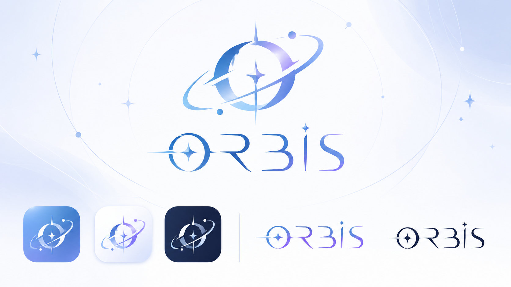

# ORBiS のロゴと文字（ブランドのきまり）

2026-11-07 にオーナーが決定。**今後、ORBiS のロゴ・アイコン・題字はこのデザインを使う。**
見本の画像：[`docs/brand/orbis-logo-guide.png`](brand/orbis-logo-guide.png)（オーナーからもらった元の画像。これが正）

## ロゴのしくみ

- **マーク（シンボル）**：惑星のような大きな「O」に、ななめの**輪（軌道）**がかかっている。O のまん中を、縦に長い**四つの光の星（✦）**がつらぬく。輪のまわりに小さな**丸い星（衛星）**が2つ。筆で払ったような、太い所と細い所のある線。
- **文字（ロゴタイプ）**：「**ORBIS**」。
  - 「O」の中に四つの光の星、O の左から**光の線**が横にのびる。
  - 「R」の右足は長く払う。「B」は上が開いた形。
  - 「i」の点は**小さな四つの光の星**。
  - 細身で、すっきりした、少し未来っぽい形（前の金色の飾り文字とはちがう）。
- **書き方**：アプリの名前としては「ORBiS」（i だけ小文字）と書く。ロゴの絵の文字は大文字の形で、i の点が星になっている。

## 色

見本の画像から拾った、だいたいの色。

| 名前 | 色 | 使うところ |
|---|---|---|
| 青（濃） | `#1a5fc0` | 文字の O・R・B、マークの左側 |
| 青（中） | `#4990dc` | マークのまん中、輪 |
| 紫（明るい） | `#8f7cf0` 〜 `#b1a4fa` | 文字の S のほう、マークの右上の光 |
| 空色 | `#7bb0f5` | 青いアイコンの地（上） |
| 青むらさき | `#6286df` | 青いアイコンの地（下） |
| 紺 | `#0f1f46` | 暗いアイコンの地 |
| いちばん濃い紺 | `#00082f` | 白い地に置くときの単色の文字 |
| うす青の白 | `#e9effc` | 白いアイコンの地・背景 |

- **ふつうの色**：青 → 紫 のグラデーション（左が青、右が紫）。
- **単色**：白い地では濃い紺 `#00082f` の1色。暗い地では白〜うす青の1色（光らせてもよい）。

## 種類（見本の下の段）

1. **青いアイコン**：空色〜青むらさきの地に、白っぽいマーク。
2. **白いアイコン**：うす青の白の地に、青〜紫のマーク。
3. **紺のアイコン**：紺の地に、白〜うす青のマーク。
4. **横長の文字ロゴ（色つき）**：青 → 紫 のグラデーション。
5. **横長の文字ロゴ（単色）**：濃い紺。

アイコンは角の丸い四角（スマホのアプリのアイコンの形）。

## アプリでの使い分け

- 明るいテーマ：色つきのロゴ（青 → 紫）または濃い紺の単色。
- 暗いテーマ：白〜うす青のロゴ（少し光らせる）。
- ブラウザのタブ・スマホのホーム画面：上の3つのアイコンのどれか（ふつうは青いアイコン）。
- 共有リンクのカードの右下の「ORBiS」も、このロゴに合わせる。

## アプリの中の画像（assets/brand/）

2026-11-07 に新しいデザインへ差しかえ済み。すべて見本の画像から切り出して作った（背景を透明にして線だけ残す）。

| ファイル | 中身 | 使う所 |
|---|---|---|
| `logo-dark.webp` | 横長の文字ロゴ（青→紫の色つき）480×140 | 明るいテーマの左上 |
| `logo.webp` | 横長の文字ロゴ（白っぽく、うすく光る）480×140 | 暗いテーマの左上、共有カードの右下 |
| `logo-full.webp` | マーク＋文字（色つき）640×495 | いまは未使用（大きく出したいとき用） |
| `icon-512.png`・`icon-192.png` | 青いアイコン（四角いっぱい。まん中8割にマーク） | ホーム画面に追加したとき（manifest）、左上の小さな四角 |
| `apple-touch-icon.png` | 同じ青いアイコン 180×180 | iPhone のホーム画面 |
| `favicon-64.png`・`favicon-32.png` | 角の丸い青いアイコン（小さくても見えるよう線を太く） | ブラウザのタブ |

| `logo-wa.webp` | 文字ロゴ（墨の文字に金のふち） | 和風テーマの左上 |
| `logo-dot.webp` | 文字ロゴ（ドット絵。右下に濃い青の影） | ドットテーマの左上 |
| `logo-aqua.webp` | 文字ロゴ（白〜水色〜青、水色の光） | アクアリウムテーマの左上 |
| `logo-book.webp` | 文字ロゴ（金箔、彫ったような影） | 魔導書テーマの左上 |

- テーマごとのロゴは、**形は同じ**で、色と質感だけをテーマに合わせて変える（2026-11-07 にオーナーの希望で追加）。新しいテーマを作るときも、同じ形のまま色・質感の版を作る。
- 2つの文字ロゴは、同じ大きさ（480×140、まわりに同じ余白）にしてある。切りかえても位置がずれないように。
- 作りなおすときは、`assets/brand/` のファイル名はそのままにして中身だけ入れかえると、コードを直す所が少なくてすむ。
